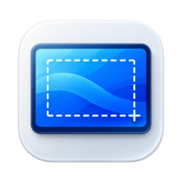
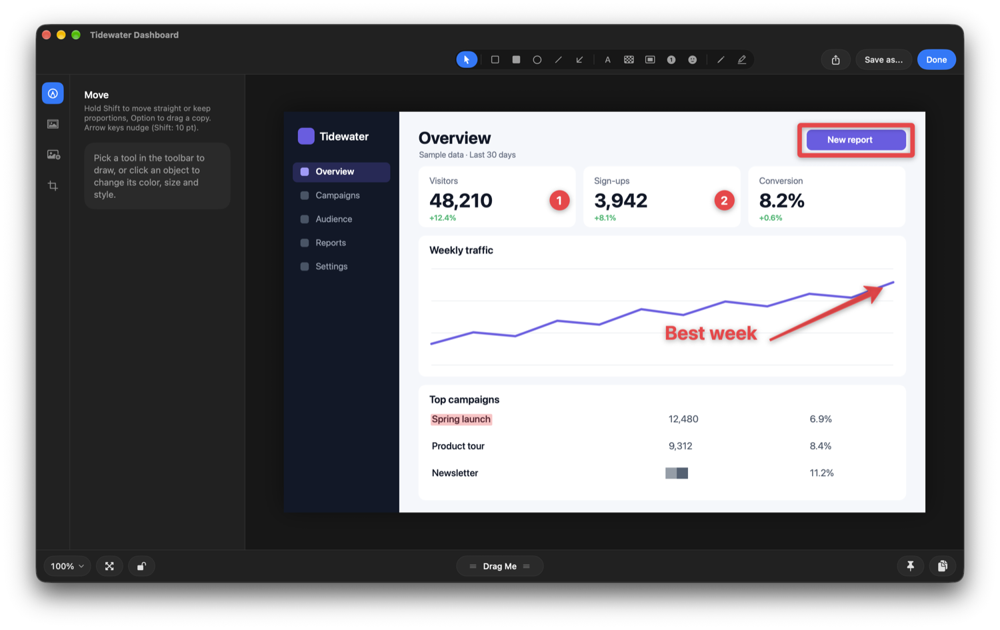
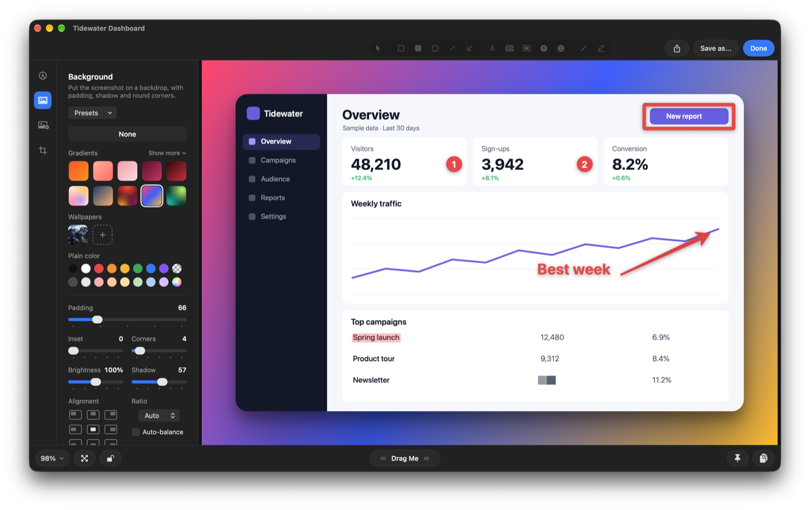
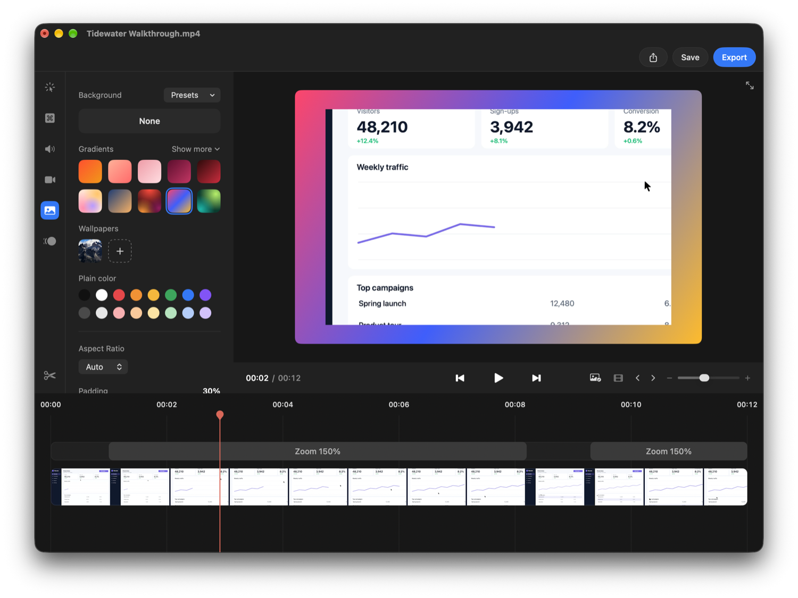
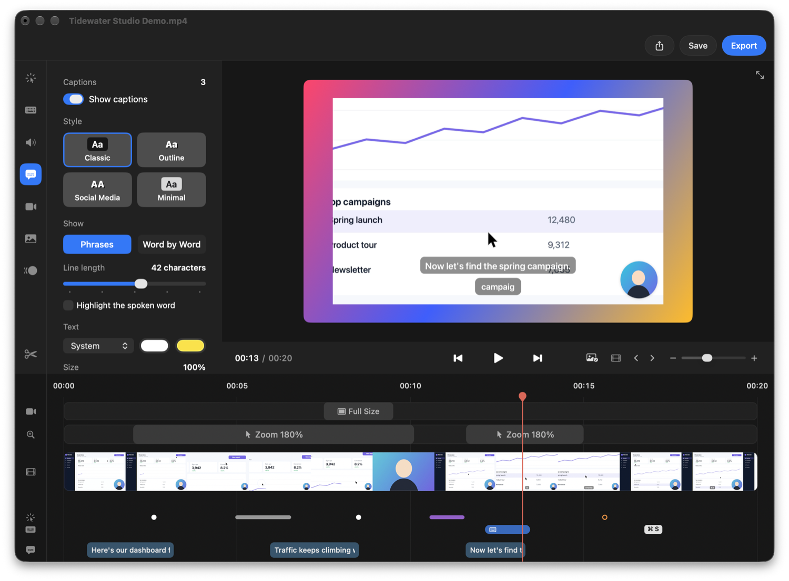
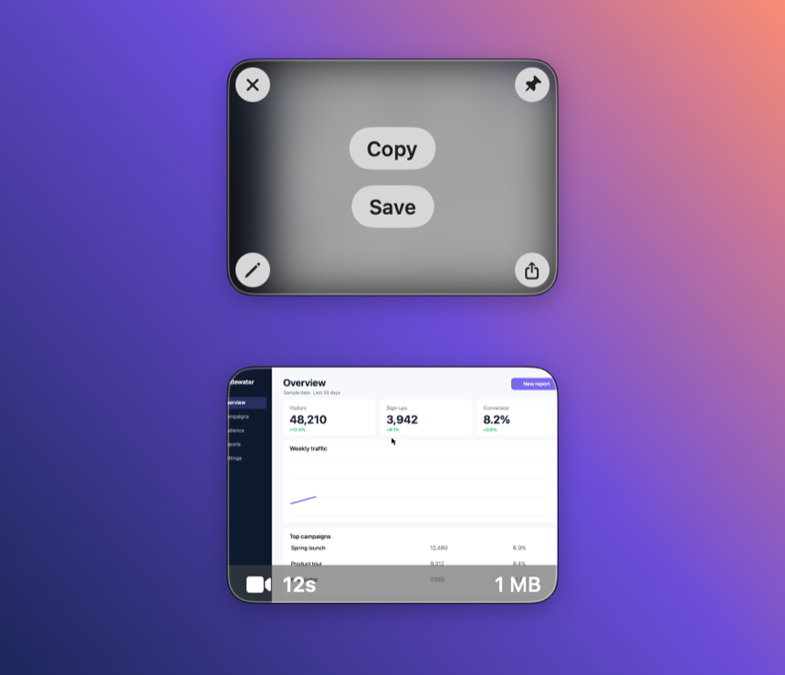
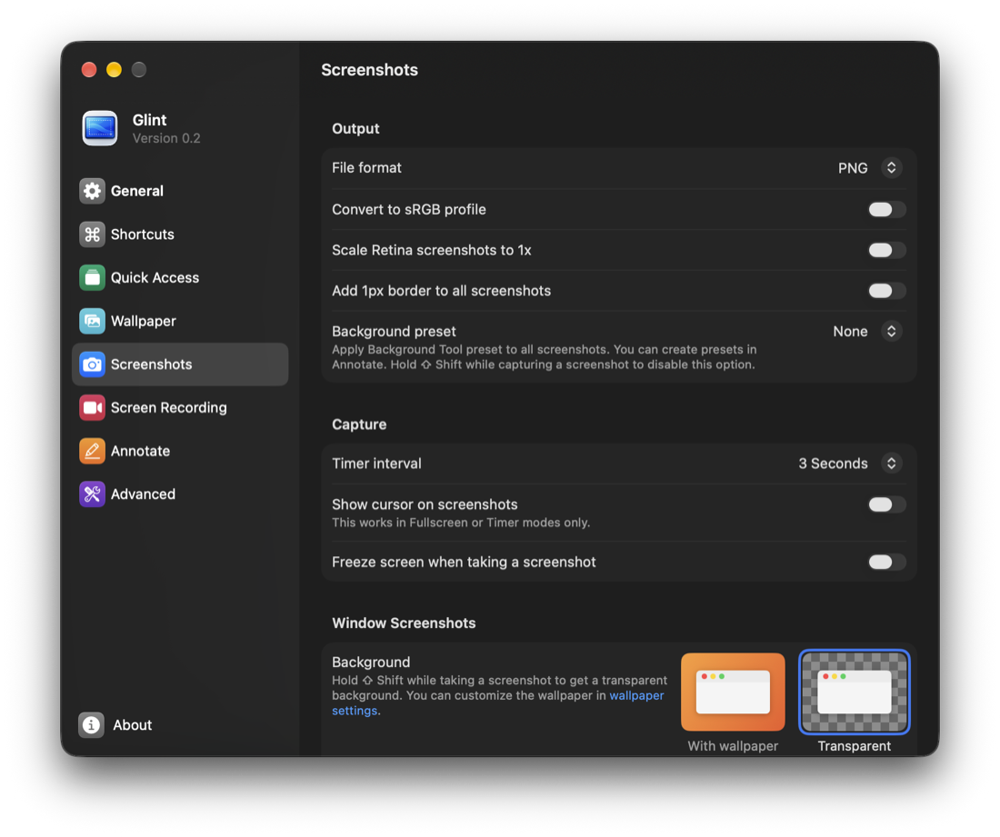

<div align="center">



# Glint

**Screenshots, screen recordings and annotations for macOS, right from the menu bar.**


[](LICENSE)

<br>

<a href="https://ko-fi.com/kuhni"></a>

</div>

---

Glint is a free, open-source screenshot and screen recording tool for the Mac. Capture any part of the screen,
annotate it, put it on a nice background, record a video or GIF, and drag the result straight into any app.

It's an independent alternative to apps like [CleanShot X](https://cleanshot.com), [Shottr](https://shottr.cc),
[Xnapper](https://xnapper.com), [Snagit](https://www.techsmith.com/snagit/), [Monosnap](https://monosnap.com) and
macOS's built-in Screenshot app. Glint is not affiliated with, endorsed by or connected to any of them; all product
names are trademarks of their respective owners.

> [!NOTE]
> Glint is in **beta (0.2)**. Expect rough edges, and please [report bugs](../../issues/new/choose). Questions and ideas
> are welcome in [Discussions](../../discussions).

## A quick look

Annotate a screenshot, put it on a background, edit a recording, and keep your latest captures at hand. (The dashboard
in these pictures is made up.)

**Screenshot editor:** arrows, shapes, text, counters, highlighter and blur.



**Backgrounds:** gradients, wallpapers, padding, shadow and round corners, with presets.



**Video editor:** trim, cut and zoom a recording, add a background, export as MP4, MOV or GIF.



**Studio Mode:** the screen, pointer, keys and camera are recorded separately, so all of it stays adjustable after
recording. Automatic zooms follow your cursor, and you can change the cursor's size, style, smoothing and click effects,
show or hide keystrokes, and move or resize the camera. The timeline shows every click, drag, scroll, shortcut and typed
word, so you can find a moment quickly or remove what shouldn't be seen.



<table>
<tr>
<td width="50%"><strong>Quick Access:</strong> your latest captures float in the corner, to copy, save, annotate, pin or drag anywhere.</td>
<td width="50%"><strong>Settings:</strong> formats, shortcuts, and what happens after each capture.</td>
</tr>
<tr>
<td></td>
<td></td>
</tr>
</table>

## Opening Glint for the first time

> [!IMPORTANT]
> **macOS will block Glint the first time you open it. This is expected for now.** Glint isn't notarized by Apple yet,
> so macOS says "Apple could not verify 'Glint' is free of malware" and offers no way to open it from that message.

To open it, once:

1. Move **Glint.app** to your **Applications** folder and open it. When the message appears, click **Done**.
2. Open **System Settings → Privacy & Security** and scroll down to **Security**.
3. Click **Open Anyway** next to the message about Glint, and confirm with your password or Touch ID.

<details>
<summary>Or use Terminal, and why this happens</summary>

Instead of the steps above, you can remove the download flag from the app, then open it as usual:

```bash
xattr -dr com.apple.quarantine /Applications/Glint.app
```

**Why:** macOS only opens downloaded apps without asking if they're signed with a paid Apple Developer ID and checked
by Apple (notarization). Glint is a free project that doesn't have this yet. It doesn't mean Glint was found to contain
anything harmful; it means Apple hasn't checked it. Only do this with a copy from this repository's
[Releases](../../releases) page. All of the source code is here, and you can [build it yourself](#building-from-source)
if you prefer.

</details>

## Contents

- [A quick look](#a-quick-look)
- [Opening Glint for the first time](#opening-glint-for-the-first-time)
- [Features](#features)
- [Requirements](#requirements)
- [Installation](#installation)
- [Getting started](#getting-started)
- [Updates](#updates)
- [Uninstalling](#uninstalling)
- [Privacy](#privacy)
- [Building from source](#building-from-source)
- [Contributing](#contributing)
- [Support the project](#support-the-project)
- [License](#license)
- [Acknowledgements](#acknowledgements)

## Features

- **Capture:** area, window (on your wallpaper with padding and shadow, or transparent), full screen, previous area,
  self-timer, All-In-One (⇧⌘5), scrolling capture, freeze screen and crosshair with magnifier.
- **Capture Text (OCR):** copy the text in any part of the screen; also reads QR codes and barcodes.
- **Annotate:** arrows, shapes, text styles, counters, pen, highlighter (snaps to text lines), blur, pixelate,
  spotlight, a magnifier for enlarged callouts, a hand-drawn look for shapes, and added images.
- **Backgrounds:** gradients, your wallpaper or any image, padding, inset, shadow, rounded corners, alignment,
  aspect ratios and presets.
- **Crop & Resize:** ratios, exact sizes, rotate and flip, output size, and a zoom lens for placing handles to the
  pixel. Saved edits stay editable.
- **Record:** screen or window as video or GIF, with microphone and system audio, camera overlay, highlighted clicks
  and keystrokes, and Do Not Disturb while recording.
- **Video editor:** trim and cut, zooms, captions from your speech (transcribed on your Mac, as phrases or word by
  word), background presets, padding, corners and shadow, keyboard scrubbing, and export to MP4, MOV or GIF.
- **Studio Mode:** record the screen as an editable project: automatic zooms that follow the cursor, cursor size,
  style, smoothing and click effects, keystrokes and the camera, all adjustable after recording.
- **Quick Access:** a floating stack of your latest captures to copy, save, annotate, pin or drag anywhere. Pull a
  card down, swipe down with two fingers or click the bar above the stack to tuck it away; pull or swipe a card toward
  the screen edge to close it.
- **Export formats:** screenshots as PNG, JPEG, HEIC or TIFF.
- **Pin to the Screen** and **Capture History** to restore earlier captures, with a **Trash** for ones you remove.
- **Open images from Finder:** any PNG, JPEG, HEIC, TIFF, WebP or BMP opens in Annotate through **Open With**.
- **Automation:** the `glint` command (`glint fullscreen` takes a screenshot and prints its path) for scripts and AI
  agents, and `glint://` links for Shortcuts, Raycast and others. See [docs/command-line.md](docs/command-line.md).

## Requirements

- macOS 15 Sequoia or later
- Apple silicon or Intel Mac

## Installation

### Download

1. Download the latest `Glint-<version>.zip` from [Releases](../../releases).
2. Unzip it and move **Glint.app** to your **Applications** folder.
3. Open Glint. macOS blocks it the first time: follow [these steps](#opening-glint-for-the-first-time).
4. Glint lives in the menu bar; there's no Dock icon.

### With an AI agent

If you use an AI coding agent (Claude Code, Codex, Cursor, …), you can let it do the setup. Ask it:

> Help me set up Glint: https://github.com/TheOnlyKuhni/Glint/blob/main/docs/agent-setup.md

[docs/agent-setup.md](docs/agent-setup.md) walks the agent through downloading, the Gatekeeper step, permissions,
turning off Apple's shortcuts and a test capture. It asks you before changing anything.

### Homebrew

A Homebrew cask is planned.

### From source

See [Building from source](#building-from-source).

## Getting started

Glint asks for a permission when a feature first needs it:

| Permission | Used for |
|---|---|
| Screen Recording | Screenshots and recordings (required) |
| Microphone / Camera | Only if you turn them on for a recording |
| Accessibility / Input Monitoring | Only for showing keystrokes in recordings and for auto-scrolling |

Default shortcuts match macOS's own screenshot shortcuts:

| Shortcut | Action |
|---|---|
| ⇧⌘3 | Capture full screen |
| ⇧⌘4 | Capture area (press Space to pick a window) |
| ⇧⌘5 | All-In-One |
| ⌃⇧⌘4 | Capture area and copy to the clipboard |

### Turn off Apple's screenshot shortcuts

While macOS's own screenshot shortcuts are on, macOS takes these keys and Glint's shortcuts don't work. To turn
them off:

1. Open **System Settings → Keyboard**.
2. Click **Keyboard Shortcuts…** and choose **Screenshots** on the left.
3. Uncheck these:
   - **Save picture of screen as a file** (⇧⌘3)
   - **Save picture of selected area as a file** (⇧⌘4)
   - **Copy picture of selected area to the clipboard** (⌃⇧⌘4)
   - **Screenshot and recording options** (⇧⌘5)
4. Click **Done**. The change works right away.

**Copy picture of screen to the clipboard** (⌃⇧⌘3) has no Glint default, so you can leave it on. Glint's
**Settings → Shortcuts** shows a warning while any of the others is still on.

If you'd rather keep Apple's shortcuts, give Glint different ones in **Settings → Shortcuts**. Every shortcut can be
changed there.

## Updates

Glint updates itself with [Sparkle](https://sparkle-project.org). It checks once a day; you can also choose
**Check for Updates…** in the menu bar menu or turn automatic checks off in **Settings → General → Updates**.
Updates are signed, and Glint only installs updates signed with the project's key.

Builds you make from source check the same feed and would update to the official release. To turn that off, remove
the `SUPublicEDKey` value from `Config/Info.plist`.

## Uninstalling

**From the app:** open **Settings → Advanced → Uninstall Glint…**. Glint deletes its settings, Capture History,
saved edits and logs, turns off Launch at Login, resets its privacy permissions, moves itself to the Trash and quits.

**With the script** (if Glint no longer opens):

```bash
curl -fsSL https://raw.githubusercontent.com/TheOnlyKuhni/Glint/main/Tools/uninstall.sh | zsh
```

**By hand:** quit Glint, move `/Applications/Glint.app` to the Trash and delete:

| Location | Contents |
|---|---|
| `~/Library/Application Support/Glint` | Capture History, Trash and saved edits |
| `~/Library/Preferences/com.philippk.glint.plist` | Settings |
| `~/Library/Logs/Glint` | Log file |
| `~/Library/Caches/com.philippk.glint` | Update cache |
| `~/Library/HTTPStorages/com.philippk.glint` | Update-check data |
| `/usr/local/bin/glint` | The command line tool's link, if you installed it |

Then remove Glint from **System Settings → Privacy & Security** (Screen Recording, Microphone, Camera,
Accessibility, Input Monitoring) and **General → Login Items**. If you set up *Do Not Disturb while recording*,
delete the "Glint Focus On" and "Glint Focus Off" shortcuts in the Shortcuts app.

Screenshots and recordings you saved (by default on your Desktop) are never removed.

## Privacy

Glint works entirely on your Mac. It has no accounts, analytics or cloud upload. The only network request is the
update check, which downloads the release feed from GitHub. Captures stay in the folders you choose and in
`~/Library/Application Support/Glint`.

## Building from source

**Requirements:** Xcode 27 or later (the project uses the macOS 27 SDK and runs on macOS 15+).

```bash
git clone https://github.com/TheOnlyKuhni/Glint.git
cd Glint
open Glint.xcodeproj
```

1. In Xcode, select the **Glint** target → **Signing & Capabilities**.
2. Choose your own **Team**, and change the **Bundle Identifier** to something of your own
   (for example `com.yourname.glint`).
3. Press **⌘R**. Xcode fetches the Sparkle package on the first build.

Or build and launch from the terminal (after setting your team once in Xcode):

```bash
Tools/run.sh
```

Signing with a stable identity keeps the Screen Recording permission across rebuilds.

**Project layout:** `Glint/` holds the app sources, grouped by feature (`Capture`, `Annotate`, `Record`,
`VideoEditor`, `QuickAccess`, `Pin`, `History`, `Settings`, …). `Config/` has Info.plist and entitlements, `Tools/`
has build, release and uninstall scripts, and [`docs/RELEASING.md`](docs/RELEASING.md) explains how releases and
updates are published.

## Contributing

Bug reports, ideas and pull requests are welcome. Please read [CONTRIBUTING.md](CONTRIBUTING.md) first.

## Support the project

<div align="center">

Glint is free and always will be. If it saves you time and you'd like to say thanks, you can support it on Ko-fi.
It's completely voluntary and very much appreciated.

<a href="https://ko-fi.com/kuhni"></a>

</div>

## License

Glint is released under the [MIT License](LICENSE).

## Acknowledgements

- [Sparkle](https://sparkle-project.org) for updates (MIT-style license, see
  [THIRD_PARTY_NOTICES.md](THIRD_PARTY_NOTICES.md)).
- Icons in the app are Apple's [SF Symbols](https://developer.apple.com/sf-symbols/), loaded from macOS at runtime
  and used under Apple's terms for apps on Apple platforms.
